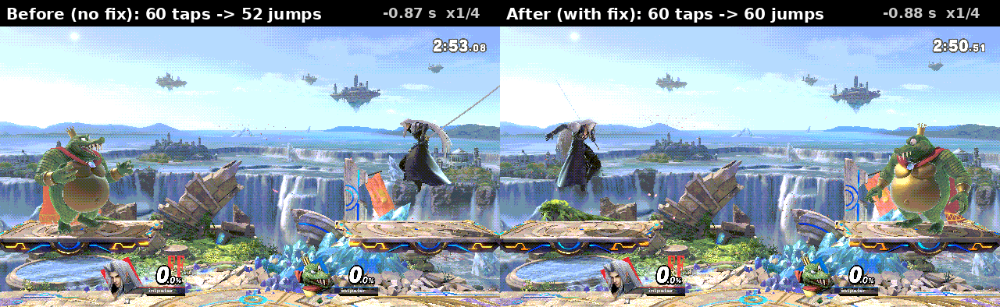

# ssbu-stall-press-carry

A Skyline plugin for Super Smash Bros. Ultimate 13.0.5. In online matches the game samples local input once per game
pass and, while it waits for the other console's input (a pass with no game frame), throws that pass's sample away
once its input buffer is full; a button press that lasts only through such a wait never reaches the game. This plugin
keeps the presses of a discarded sample and adds them to the next input record the game commits, so the press lands
one frame later instead of not at all. Since 0.2.0 it does the same for a flick of either stick (see below). It changes only
this console's own input record before the game packs and sends it, so both consoles simulate the same input. Releases
and the input delay are unchanged.



*Eden, 2026-11-12, at quarter speed. The other console runs at 70% speed, so this one often waits for it. Jump is
tapped for one frame every 0.8 s.*
- *Left, without the plugin:* tap 9 lands on a pass whose sample is thrown away, and the fighter stays on the ground.
  In that run, 60 taps gave 52 jumps.
- *Right, with the plugin* (`02420ee`'s source with its diag log, build `dcec9d1a`): tap 13 lands on such a pass too.
  It is carried into the next input record, and the fighter jumps. In that run, 60 taps gave 60 jumps.

The single clips are `docs/evidence/before.gif` and `docs/evidence/after.gif`.

- **Install:** `atmosphere/contents/01006A800016E000/romfs/skyline/plugins/libssbu_stall_press_carry.nro`.
- **Log:** `sd:/ultimate/ssbu-stall-press-carry/events.log`, the install line only.
- **Hook sites** (13.0.5 `.text`, 64-byte guards, inline): `0x16d81dc` (the lockstep's commit path, before the record
  is packed) and `0x16d8714` (after the commit or the drop). Both or neither are installed.
- **Not covered:** a flick that becomes a different direction by the next frame (a dash-dance reversal, left alone);
  releasing and pressing again a held button within one wait.

## Stick flicks (0.2.0)

A sample the game throws away can hold a stick flick that is gone again by the next frame: on the left stick a dash, a
smash attack or a fast fall; on the right stick (the C-stick) a smash attack or an aerial. Each stick is judged on its
own, with the same rule, so one wait can carry both. The stick bytes are a float times 120. The plugin uses its own
thresholds, not the game's parameters: a dead zone of 24 (0.2) and a flick strength of 84 (0.7). A stick's bin is the
sign of each axis beyond the dead zone.
- **A dropped sample's stick is a flick** when it leaves the last committed bin for another non-neutral bin, or reaches
  flick strength in the same bin from below it. Going back to neutral is a release.
- **At the next commit:**
  - **Carried:** if the stick has gone back (dead zone, the last committed bin, or weaker in the flick's bin), the
    dropped position is put into that one commit's bytes for that stick.
  - **Left alone:** if the stick still shows the flick, it arrives anyway.
  - **Lost (reversal):** if the stick now points in a new direction (a dash-dance reversal), the new direction wins.
  - **Lost (superseded):** two flicks in different directions in one wait keep the later one.
- **Buttons** are carried as in 0.1.0.
- **Counters:** both sticks count into the same `flick_carried` and `flick_lost` fields. The diag build's carry line
  names the stick (`stick=left|right`).

**Why both consoles stay in sync:** the plugin writes only this console's own local samples, in the commit path, before
the game packs them into the input record it both sends and consumes. The other console receives that record and
simulates the same frame from it. No simulated state is written and no random number is drawn.

## Counters (0.2.0)

Per lockstep session, mirrored into atomics by the two hooks. A session starts when the session address changes or
when a pass comes more than 2 s after the last one (the next match can reuse the address; within a match the hooks run
every pass, stalled or not). A new session also drops any carry still pending. The counters:
- the decisions, commits and dropped samples (each drop is a stalled pass at the steady lead);
- the press edges in committed samples;
- the commits that received carried presses, with the press bits and the groups: jump, attack, special, shield, grab
  and other;
- `flick_carried`, and `flick_lost` by reason (`reversal`, `superseded`).

**The export:** `ssbu_stall_press_carry_stats_v1(out: *mut StatsV1) -> bool`, an `extern "C"` function looked up with
`nn::ro::LookupSymbol`.
- `StatsV1` is 18 `u32` fields, `size` (72) and `version` (1) first. The order is in `src/model.rs`.
- It returns false only for a null `out`. Lock-free, any thread.
- The desync detector 0.5.0 appends these counters to its session-end summary.
- The release build adds no log line; its install line says `stats=v1`.

## Build

```text
pwsh -File tools/build.ps1 -Kind test        # cargo test
pwsh -File tools/build.ps1 -Kind clippy      # cargo clippy --all-targets -- -D warnings
pwsh -File tools/build.ps1 -Kind nodefault   # cargo build --no-default-features
pwsh -File tools/build.ps1 -Kind release     # cargo skyline build --release -> dist/release
pwsh -File tools/build.ps1 -Kind diag        # the Eden diagnostic build -> dist/diag
```

License: MIT, see [LICENSE](LICENSE).

> **Disclaimer:** this project was developed with the assistance of AI
> (Claude) under the operator's direction and review. Nothing is claimed
> beyond the dated tests in `docs/EDEN-RESULTS.md`.
