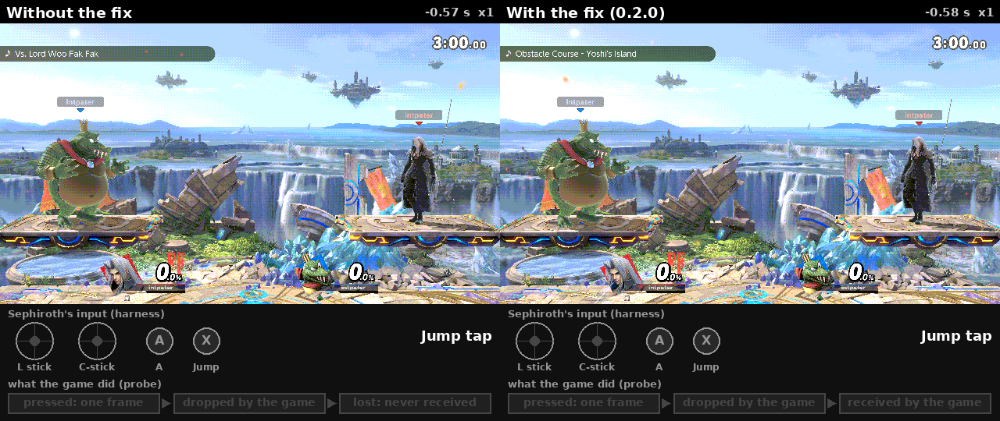
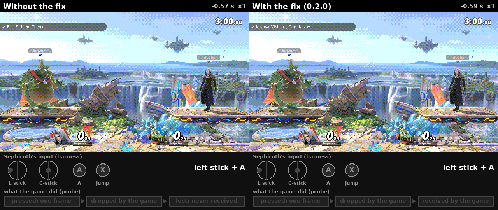
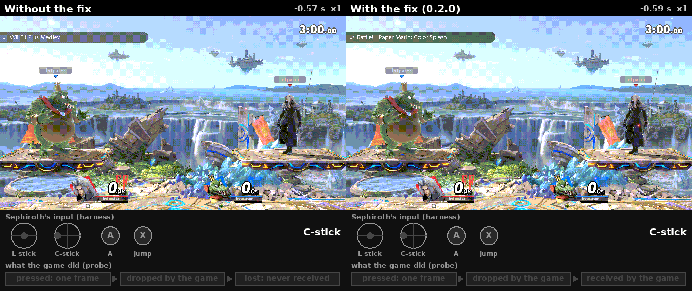

# ssbu-stall-press-carry

In online and local wireless matches, Super Smash Bros. Ultimate sometimes throws away a button press or stick flick
that lasted only one frame. This plugin hands that input to the game on the next frame instead, so the move still
comes out.

In each GIF below, the press is Sephiroth's (on the right of each game). K. Rool (on the left) is the other
console's CPU and moves on its own. The other console is made to stall for 0.7 s right at the press. That makes the
game drop the press every time, which is what an online lag spike does.

**A Jump tap:** without the plugin (left half) the dropped tap never jumps; with it (right half) Sephiroth jumps.

**Left stick + A toward the opponent:** without the plugin the dropped smash never comes out; with it, it does.

**A C-stick smash toward the opponent:** without the plugin nothing happens; with it, the smash comes out.

*Eden, 2026-11-13. Each pair is two matches set up the same way: 0.6 s after GO, with both fighters on their spawn
points at 0%, one one-frame press toward the opponent. The press is Sephiroth's (right); K. Rool (left) is the other
console's CPU and moves on its own. The other console stalls for a moment (0.7 s, set up for this clip), so the game
drops the press. Left half: without the plugin. Right half: version 0.2.0 (diag build `89980fba`: the release
`749ed165` plus a log line). Under each game: what Sephiroth's console pressed, and what the game did with it. Half
speed after the press.*

- **Install:** copy `libssbu_stall_press_carry.nro` to
  `atmosphere/contents/01006A800016E000/romfs/skyline/plugins/` (Smash 13.0.5).
- **Where it works:** online and local wireless matches, not offline.
- **Counts:** with the desync detector 0.5 or later installed, each match's summary line in
  `sd:/ultimate/ssbu-desync-detector/events.log` says how many presses and flicks this plugin carried.

How it works and how it was tested: [docs/TECHNICAL.md](docs/TECHNICAL.md), [docs/EDEN-RESULTS.md](docs/EDEN-RESULTS.md).
Build: `cargo skyline build --release`. License: MIT, see [LICENSE](LICENSE).

> **Disclaimer:** this project was developed with the assistance of AI
> (Claude) under the operator's direction and review. Nothing is claimed
> beyond the dated tests in `docs/EDEN-RESULTS.md`.
